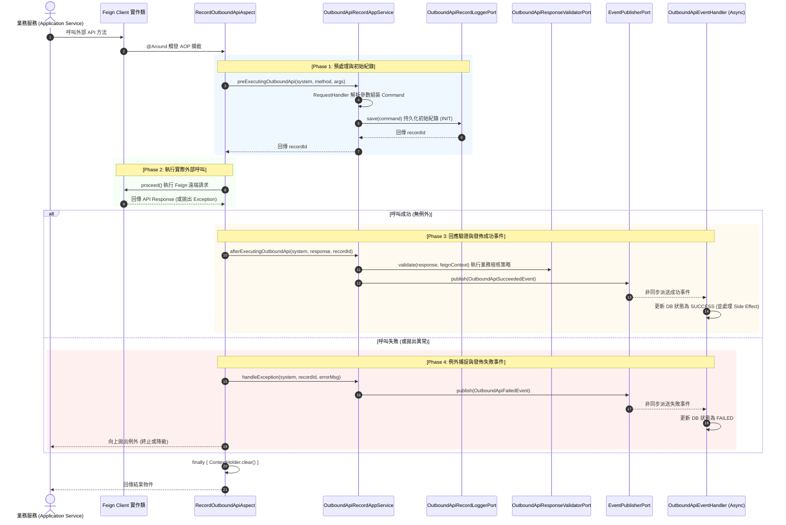
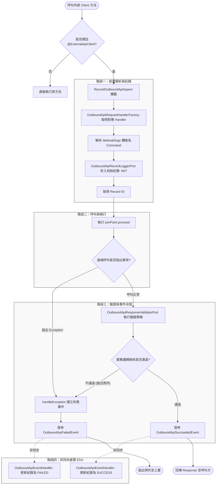

# Outbound API Recording & Validation Module

[](https://www.oracle.com/java/)
[](https://spring.io/projects/spring-boot)
[](https://spring.io/projects/spring-cloud-openfeign)
[]()
[](http://localhost:8080/swagger-ui.html)

---

## 📖 專案定位與核心價值

本模組旨在**統一管理對外部系統 (Outbound) API 的呼叫紀錄、結果檢核與非同步處理**。透過標準化、策略化與非侵入式的架構設計，徹底解決傳統第三方 API 介接時常見的痛點：

### 傳統痛點 vs. 本模組解決方案

| 痛點維度 | 傳統做法問題 | 本模組解決方案 |
| :--- | :--- | :--- |
| **程式碼侵入性** | 每次發送外部請求前後皆需手動寫 Log、記錄 DB，業務邏輯充斥樣板代碼 | **AOP 統一攔截**：透過 `@ExternalApiClient` 標註，呼叫前後自動完成稽核與事件分派 |
| **架構耦合度** | Feign 細節、HTTP Status、例外或 DB Entity 直接穿透至 Application / Domain | **Clean Architecture**：Application 層僅依賴抽象 Port，隔離技術框架細節 |
| **結果判定標準** | 僅依賴 HTTP 200 判定成功，忽略各系統業務層自定義代碼（如 `code != "0000"`） | **雙層策略化驗證**：支援依 `system` 與特定 API 定義專屬的業務成功 / 失敗檢核策略 |
| **效能與副作用** | 更新 API 狀態、持久化稽核日誌與業務主執行緒同步執行，增加延遲 | **事件驅動架構 (EDA)**：發佈 Domain Event，透過非同步事件監聽器更新紀錄與執行副作用 |

---

## 🏛️ 核心架構設計

本模組遵循 **Clean Architecture (Hexagonal Architecture / 六角架構)** 與 **EDA (Event-Driven Architecture)** 原則，依職責劃分為四個核心層級：

```
src/main/java/com/example/demo/
├── iface/                 # 介面轉接層 (Interface / Adapter Layer - Inbound Adapters)
│   ├── aspect/            # AOP 外部 API 呼叫攔截器 (RecordOutboundApiAspect)
│   ├── rest/              # RESTful API 控制器 (AuthController)
│   ├── event/             # Domain Event 監聽器 (OutboundApiEventHandler)
│   ├── resource/          # 表現層純資料載體 (Request / Response Resources)
│   │   ├── in/            # 請求載體 (GetJwTokenResource)
│   │   └── out/           # 回應載體 (JwTokenGottenResource, JwTokenGottenData, PermissionGottenResource, PermissionGottenData)
│   ├── assembler/         # 表現層防腐轉換器 (AuthResourceAssembler)
│   ├── interceptor/       # 請求攔截器 (Context 清理等)
│   └── exception/         # 全域例外處理 (GlobalExceptionHandler)
│
├── application/           # 應用邏輯層 (Application Layer)
│   ├── service/           # 應用服務 (OutboundApiRecordApplicationService, AuthApplicationService)
│   ├── port/              # 埠合約介面 (Ports)
│   │   ├── in/            # Inbound Ports / UseCases (GetJwTokenUseCase, GetPermissionListUseCase)
│   │   └── out/           # Outbound Ports (AuthServiceClientPort, OutboundApiRecordLoggerPort 等)
│   ├── factory/           # 策略工廠 (Request/Response/Validator Factories)
│   └── shared/            # Command Records, Domain Events, Result DTOs
│       ├── command/       # 命令 Record (GetJwTokenCommand, RecordOutboundApiRequestCommand 等)
│       ├── dto/           # 查詢結果 DTO (JwTokenGottenResult, PermissionGottenResult)
│       ├── event/         # 領域事件 (OutboundApiSucceededEvent, OutboundApiFailedEvent)
│       └── outbound/auth/ # Outbound 專屬業務意圖 (GetJwTokenFromAuthCommand, GetPermissionListFromAuthQuery)
│
├── infra/                 # 基礎設施層 (Infrastructure Layer - Outbound Adapters)
│   ├── adapter/           # Application Port 具體實作 (AuthServiceClientAdapter, OutboundApiRecordLoggerAdapter 等)
│   ├── outbound/          # OpenFeign Client、ErrorDecoder、ExceptionMapper、驗證策略
│   │   ├── feign/client/  # Feign 客戶端 (AuthFeignClient)
│   │   └── shared/dto/    # 外部原生傳輸 DTO (JwTokenGottenFromAuthData, PermissionGottenFromAuthData)
│   ├── persistence/record/# JPA Entity (OutboundApiRecord) 與 Repository（詳見 Entity 設計文件）
│   └── annotation/        # 核心標註 (@ExternalApiClient)
│
└── config/                # Spring 配置 (Async, Feign, Factory Beans)
```

> [!NOTE]
> **依賴原則 (Dependency Rule)**：外層依賴內層，內層決不依賴外層。`Application Layer` 僅依賴定義好的 `Port` 介面，完全不感知 JPA `@Entity`、`Repository` 或 Feign 的具體實作。

---

## 🔄 核心執行流程

### 1. 時序圖 (Sequence Diagram)



### 2. 決策流程圖 (Flowchart)



---

## 🧩 核心元件說明

### 1. 標註 `@ExternalApiClient`
* **位置**：標註於 Client 的**實作類別 (Implementation Class)**。
* **屬性**：`system()` 定義所屬外部系統代碼（例如 `"AUTH_SERVICE"`），作為 AOP、工廠模式分流的路由鍵。

### 2. 連接埠與工廠 (Ports & Factories)
* **`OutboundApiRequestHandlerPort`**：負責將反射截獲的 `Method` 與 `args` 解析為通用的 `RecordOutboundApiRequestCommand`。
* **`OutboundApiRecordLoggerPort`**：Application 層專屬儲存介面，負責將 Command 持久化，回傳紀錄唯一鍵 `recordId`，完全與 JPA 實體解耦。
* **`OutboundApiResponseValidatorPort`** 與 **`ApiResponseValidationStrategy`**：雙層檢核設計。Port 負責依系統分流，Strategy 負責個別 API 具體的回應內容檢驗（如檢查狀態碼、錯誤訊息）。
* **`OutboundApiResponseHandlerPort`**：負責收斂最後的成功與失敗處理，更新記錄狀態與附加資訊。

### 3. 上下文管理器 (`ContextHolder`)
* 基於 `ThreadLocal` 實現，在 Feign 調用鏈中安全儲存該次請求的 URI、HTTP Method 與 Header，確保在多執行緒與非同步分派中維持資料隔離，並於 `finally` 區塊強制 `clear()` 避免記憶體洩漏。

### 4. 自定義 API 回應驗證策略 (`infra/outbound/validation/`)
* **`ApiResponseValidationStrategy`**：定義單一 API 級別的回應檢核規格。每支策略實作只需宣告：
  * `system()`：所屬外部系統（如 `"AuthService"`, `"PAYMENT_SERVICE"`）
  * `api()`：所對應的 API 路徑（如 `"/api/v1/login"`）
  * `validate(Object response, OutboundApiRequestInfo context)`：具體業務檢核規則
* **`ApiResponseValidationStrategyFactory`**：策略工廠，啟動時以 `system:api` 為 Key 自動註冊快取，執行期以 $O(1)$ 速度精準路由，避免繁複的 `if-else`。
* **主要用途**：突破僅以 HTTP 200 判定成功的限制，深入檢核 Payload（如業務錯誤碼、Token 存在性、簽章校驗）。

### 5. 自定義系統例外轉換器 (`infra/outbound/exception/`)
* **`ExternalExceptionMapper`**：定義系統級別的錯誤轉譯規格。每個實作宣告：
  * `supports(String system)`：判斷是否支援該外部系統代碼
  * `map(int httpStatus, String responseBody, OutboundApiRequestInfo context)`：將外部原始錯誤 Payload 轉譯為系統內部統一的 `OutboundClientException`（繼承自應用層 `ExternalServiceException`）
* **`ExternalExceptionMapperFactory`**：工廠模式，依系統名稱動態指派專屬 Mapper；若未配置專屬 Mapper 則自動退回 `DefaultExternalExceptionMapper`（Fallback 機制）。
* **主要用途**：徹底落實防腐層（ACL），隔離各外部廠商特殊的錯誤代碼與訊息結構，避免外部廠商技術規格外洩。

### 6. 錯誤解碼器 (`FeignErrorDecoder`)
* 實作 OpenFeign 的 `ErrorDecoder` 介面，攔截非 2xx HTTP 狀態碼與通訊異常，並委派對應的驗證策略與例外轉換器處理。

---

## 🚀 擴充指引：如何新增一個外部系統？

當專案需要對接新的外部第三方系統（例如 `PAYMENT_SERVICE`）時，只需遵循以下五個擴充步驟：

### 步驟 1：定義 Client 並標註 `@ExternalApiClient`
```java
@Component
@ExternalApiClient(system = "PAYMENT_SERVICE")
@RequiredArgsConstructor
public class PaymentServiceClientAdapter implements PaymentServiceClientPort {
    private final PaymentFeignClient feignClient;

    @Override
    public PaymentResult pay(PayCommand command) {
        return feignClient.requestPayment(command);
    }
}
```

### 步驟 2：實作 Request Handler (解析請求參數)
實作 `OutboundApiRequestHandlerPort`，解析該系統特有的請求格式與參數：
```java
@Component
public class PaymentServiceRequestHandlerAdapter implements OutboundApiRequestHandlerPort {
    @Override
    public String supportSystem() {
        return "PAYMENT_SERVICE";
    }

    @Override
    public RecordOutboundApiRequestCommand resolveRequest(Object target, Method method, Object[] args) {
        // 提取 Path、Query、Body 並回傳標準 Command
    }
}
```

### 步驟 3：自定義 API 回應驗證策略 (`ApiResponseValidationStrategy`)
為該系統特定 API 端點定義細緻的業務檢核邏輯（放置於 `infra/outbound/validation/strategy/`）：
```java
@Component
public class PaymentPayValidationStrategy implements ApiResponseValidationStrategy {
    @Override
    public String system() {
        return "PAYMENT_SERVICE";
    }

    @Override
    public String api() {
        return "/api/v1/payments";
    }

    @Override
    public void validate(Object response, OutboundApiRequestInfo context) {
        if (response instanceof PaymentResponse res && !"SUCCESS".equalsIgnoreCase(res.getStatus())) {
            throw new OutboundClientException("PAYMENT_FAILED", "扣款業務檢核失敗: " + res.getErrorMessage());
        }
    }
}
```

### 步驟 4：自定義系統例外轉換器 (`ExternalExceptionMapper`)
為該系統定義專屬的例外轉譯邏輯，處理非 2xx 或異常回應（放置於 `infra/outbound/exception/mapper/impl/`）：
```java
@Component
public class PaymentExceptionMapper implements ExternalExceptionMapper {
    @Override
    public boolean supports(String system) {
        return "PAYMENT_SERVICE".equals(system);
    }

    @Override
    public RuntimeException map(int httpStatus, String responseBody, OutboundApiRequestInfo context) {
        // 將外部金流系統特殊的 JSON 錯誤格式解析為統一的 OutboundClientException
        return new OutboundClientException("PAYMENT_HTTP_" + httpStatus, "金流服務呼叫失敗: " + responseBody);
    }
}
```

### 步驟 5：實作 Response Handler (處理結果副作用)
實作 `OutboundApiResponseHandlerPort`，提供該系統在收到成功/失敗領域事件後的後續處理（如更新記錄狀態）：
```java
@Component
public class PaymentServiceResponseHandlerAdapter implements OutboundApiResponseHandlerPort {
    @Override
    public String supportSystem() {
        return "PAYMENT_SERVICE";
    }

    @Override
    public void handleSuccess(RecordSuccessOutboundApiCommand command) {
        // 更新 DB 紀錄狀態為 SUCCESS
    }

    @Override
    public void handleFailure(RecordFailedOutboundApiCommand command) {
        // 更新 DB 紀錄狀態為 FAILED
    }
}
```

---

## ⚠️ 開發規範與最佳實踐

> [!IMPORTANT]
> 1. **標註位置**：`@ExternalApiClient` **必須標註在 Spring Bean 實作類別上**，而非 Feign 介面本身，確保 Spring AOP 動態代理能正確攔截。
> 2. **系統唯一性**：各系統的 `system` 代碼必須維持唯一性，以確保工廠（Factory）能精準路由。
> 3. **Clean Architecture 隔離**：Application Layer 絕對不可直接 import 或調用 `infra.persistence` 底下的 `@Entity` 與 JPA `Repository`，必須一律走 `port`。
> 4. **執行緒清理**：使用 `ContextHolder` 時，切記在 AOP 的 `finally` 區塊以及 MVC `HandlerInterceptor` 中呼叫 `ContextHolder.clear()`。
> 5. **OpenAPI / Swagger 文檔**：啟動專案後，可瀏覽 [Swagger UI](http://localhost:8080/swagger-ui.html) 查看與測試所有暴露的 API 端點。
