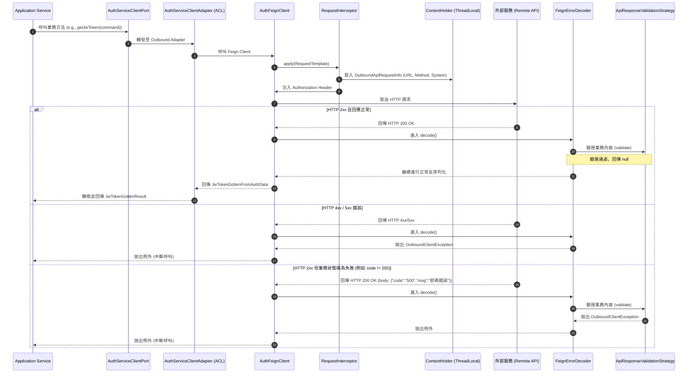

# OpenFeign Client 架構與技術整合指南 (Feign Client Technical Guide)

本文件專門針對本模組中 **OpenFeign Client** 的整合架構、設計模式、生命週期流程、攔截器與防腐層（ACL）轉換進行詳細說明，並遵循 **Clean Architecture（六角形架構）** 與 **DDD（領域驅動設計）** 原則。

---

## 1. 架構定位與設計理念

在六角形架構中，外部 HTTP API 的呼叫屬於 **Outbound Infrastructure（基礎設施出站適配）**。為了維持領域核心與應用層的純粹性，我們採用了分層隔離與防腐層機制：

```
+-----------------------------------------------------------------------------------+
| Application Layer                                                                 |
|                                                                                   |
|  [Use Case] ---> (AuthServiceClientPort)  <-- Inbound/Outbound Port               |
|                           ^                                                       |
+---------------------------|-------------------------------------------------------+
                            | implements
+---------------------------|-------------------------------------------------------+
| Infrastructure Layer      |                                                       |
|                           |                                                       |
|                 [AuthServiceClientAdapter]  <-- ACL 防腐層與資料轉換 (Outbound Adapter) |
|                           |                                                       |
|                           v calls                                                 |
|                   [AuthFeignClient]         <-- 宣告式 HTTP Client (OpenFeign)     |
|                           |                                                       |
|                           v requests via                                          |
|                [RequestInterceptor]        <-- 注入 JWT Header、寫入 ContextHolder |
|                           |                                                       |
|                           v responses via                                         |
|                 [FeignErrorDecoder]        <-- 攔截 4xx/5xx 與業務異常檢核         |
|                           |                                                       |
|                           v throws                                                |
|               [OutboundClientException]     <-- 繼承 ExternalServiceException (DIP)|
+-----------------------------------------------------------------------------------+
```

### 關鍵職責邊界
1. **Application Port (`AuthServiceClientPort`)**：
   - 僅接收與回傳 Application 專屬物件（`Command`, `Query`, `Result`）。
   - 嚴格禁止引用 Feign、HTTP 或第三方廠商 DTO。
2. **Outbound Adapter (`AuthServiceClientAdapter`)**：
   - 實作 Application Port，標註 `@ExternalApiClient(system = "AuthService")`。
   - 扮演 **Anti-Corruption Layer (ACL, 防腐層)**，負責將 Feign Client 回傳的 `Data` 轉換為 Application 層的 `Result`。
3. **Feign Client (`AuthFeignClient`)**：
   - 純 Spring Cloud OpenFeign 介面，宣告 HTTP 端點、路徑與請求參數。
   - 僅處理 HTTP 通訊協定細節。
4. **Feign Configuration (`AuthFeignConfiguration` & `GlobalFeignConfiguration`)**：
   - 配置 Apache HttpClient（支援 PATCH 與 SSL 憑證忽略）、日誌等級（`Logger.Level.FULL`）。
   - 註冊全域 `ErrorDecoder` 與系統專屬的 `RequestInterceptor`。

---

## 2. 核心組件與互動流程

### 2.1 完整呼叫時序圖 (Sequence Diagram)



---

## 3. 組件詳細解析

### 3.1 宣告式 Feign Client 介面

[AuthFeignClient.java](file:///d:/桌面/ModuleWorkSpace/outbound-api-recording-module/src/main/java/com/example/demo/infra/outbound/feign/client/AuthFeignClient.java) 定義了與外部系統溝通的 HTTP Contract：

```java
@FeignClient(
    value = "AuthFeignClient",
    url = "${auth.service.endpoint}",
    configuration = AuthFeignConfiguration.class
)
public interface AuthFeignClient {

    @PostMapping(value = "/api/v1/login")
    JwTokenGottenFromAuthData getJwToken(@RequestBody GetJwTokenFromAuthCommand command);

    @GetMapping(value = "/api/v1/auth/permissions")
    PermissionGottenFromAuthData getPermissionList(@RequestParam String username);
}
```

- **`configuration`**：指定專屬組態類別 `AuthFeignConfiguration.class`。
- **`url`**：使用 Spring Property 佔位符動態讀取外部伺服器網址。

---

### 3.2 請求攔截器 (Request Interceptor) 與上下文建立

位於 [AuthFeignConfiguration.java](file:///d:/桌面/ModuleWorkSpace/outbound-api-recording-module/src/main/java/com/example/demo/config/AuthFeignConfiguration.java)：

```java
@Bean
public RequestInterceptor requestTokenInterceptor() {
    return new RequestInterceptor() {
        @Override
        public void apply(RequestTemplate requestTemplate) {
            String method = requestTemplate.method();
            String url = requestTemplate.url();

            // 1. 建立對外 API 呼叫的上下文資訊
            OutboundApiRequestInfo context = OutboundApiRequestInfo.builder()
                    .system("AuthService")
                    .httpMethod(method)
                    .url(String.format("%s%s", endpoint, url))
                    .api(url)
                    .build();

            // 2. 寫入 ThreadLocal 供後續 ErrorDecoder 與 AOP 記錄器使用
            ContextHolder.setFeignContext(context);

            // 3. 注入外部系統所需的授權 Header
            requestTemplate.header(
                JwtConstants.JWT_HEADER.getValue(),
                JwtConstants.JWT_PREFIX.getValue() + token
            );
        }
    };
}
```

> [!IMPORTANT]
> **ContextHolder 的重要性**：透過 `ContextHolder.setFeignContext(context)`，請求的 URL、HTTP Method 與外部系統識別代碼能夠在不修改 Feign 介面簽署的前提下，於多執行緒隔離的 `ThreadLocal` 中傳遞至 `FeignErrorDecoder`，做為選擇對應檢核策略的 Key。

---

### 3.3 HTTP Client 與 SSL 配置 (Apache HttpClient)

預設的 JDK `HttpURLConnection` 不支援 HTTP `PATCH` 請求，且在連線池與 SSL 客製化上受限。在 [AuthFeignConfiguration.java](file:///d:/桌面/ModuleWorkSpace/outbound-api-recording-module/src/main/java/com/example/demo/config/AuthFeignConfiguration.java) 中覆寫底層 Client：

```java
@Bean
public Client feignClient() throws KeyManagementException, NoSuchAlgorithmException, KeyStoreException {
    // 允許信任所有憑證 (依開發/測試環境需求，生產環境建議改用正式 CA 驗證)
    SSLContext sslContext = SSLContextBuilder.create()
            .loadTrustMaterial((chain, authType) -> true)
            .build();

    CloseableHttpClient httpClient = HttpClients.custom()
            .setSSLContext(sslContext)
            .setSSLHostnameVerifier(NoopHostnameVerifier.INSTANCE)
            .build();

    return new ApacheHttpClient(httpClient);
}
```

---

### 3.4 統一錯誤解碼器 (FeignErrorDecoder) 與業務校驗

標準的 Feign 只會在 HTTP 狀態碼為非 2xx 時進入 `ErrorDecoder`。但是在微服務中，許多第三方系統常使用 **HTTP 200 包含業務錯誤碼**（如 `{ "code": 500, "message": "帳號密碼錯誤" }`）。

[FeignErrorDecoder.java](file:///d:/桌面/ModuleWorkSpace/outbound-api-recording-module/src/main/java/com/example/demo/infra/outbound/feign/decoder/FeignErrorDecoder.java) 結合了 HTTP 狀態碼檢驗與業務內容檢核：

```java
@Override
public Exception decode(String methodKey, Response response) {
    OutboundApiRequestInfo context = ContextHolder.getFeignContext();
    String body = extractResponseBody(response);

    // 1. 若 HTTP 狀態碼非 2xx (例如 4xx, 5xx)，封裝為專案自定義的 OutboundClientException
    if (response.status() < 200 || response.status() >= 300) {
        return new OutboundClientException(
            "HTTP_" + response.status(),
            "HTTP Error: " + response.status() + ", body=" + body
        );
    }

    // 2. 若 HTTP 狀態碼為 2xx，進一步委派給對應系統的 Validator 執行業務層級驗證 (例如業務錯誤碼檢查)
    try {
        if (context != null && context.system() != null) {
            validatorFactory.get(context.system()).validate(body, context);
        }
    } catch (RuntimeException e) {
        log.error("外部 API 回應業務檢核失敗: system={}, error={}", context.system(), e.getMessage());
        return e;
    }

    // 3. 回應成功且未違反業務檢核規則時回傳 null，Feign 將正常反序列化 Response Body
    return null;
}
```

---

### 3.5 防腐層 (ACL) 與 Outbound Adapter

[AuthServiceClientAdapter.java](file:///d:/桌面/ModuleWorkSpace/outbound-api-recording-module/src/main/java/com/example/demo/infra/adapter/AuthServiceClientAdapter.java) 實作應用層的 Port，阻絕外部 Data 侵入應用層：

```java
@Component
@AllArgsConstructor
@ExternalApiClient(system = "AuthService")
class AuthServiceClientAdapter implements AuthServiceClientPort {

    private final AuthFeignClient client;

    @Override
    public JwTokenGottenResult getJwToken(GetJwTokenFromAuthCommand command) {
        // 呼叫 Feign Client 取得基礎設施層的 Data DTO
        JwTokenGottenFromAuthData data = client.getJwToken(command);
        // 轉換為應用層專屬的 Result 物件
        return data != null ? new JwTokenGottenResult(data.getToken()) : null;
    }
}
```

---

## 4. 擴充指引：新增一個外部 Feign Client

當需要介接新的外部服務（例如 `PaymentService`）時，請依照下列步驟進行開發：

### 步驟 1：定義 Application Outbound Port 與 Result
在 `com.example.demo.application.port.out` 定義業務合約：
```java
public interface PaymentServiceClientPort {
    PaymentResult executePayment(PayOrderCommand command);
}
```

### 步驟 2：定義 Feign Client 與 DTO
在 `infra/outbound/feign/client/` 與 `infra/outbound/shared/dto/`：
```java
@FeignClient(
    value = "PaymentFeignClient",
    url = "${payment.service.endpoint}",
    configuration = PaymentFeignConfiguration.class
)
public interface PaymentFeignClient {
    @PostMapping("/api/v1/pay")
    PaymentResponseData pay(@RequestBody PaymentRequestData request);
}
```

### 步驟 3：撰寫專屬 Configuration 與 Interceptor
在 `config/PaymentFeignConfiguration.java`：
```java
@Configuration
public class PaymentFeignConfiguration {
    @Bean
    public RequestInterceptor paymentRequestInterceptor() {
        return template -> {
            OutboundApiRequestInfo context = OutboundApiRequestInfo.builder()
                .system("PaymentService")
                .httpMethod(template.method())
                .url(template.url())
                .api(template.url())
                .build();
            ContextHolder.setFeignContext(context);
            template.header("X-API-KEY", "secret-key");
        };
    }
}
```

### 步驟 4：建立業務回應驗證策略 (Validation Strategy)
在 `infra/outbound/validation/strategy/payment/`：
```java
@Component
public class PaymentValidationStrategy implements ApiResponseValidationStrategy {
    @Override
    public String supportSystem() { return "PaymentService"; }
    @Override
    public String supportApi() { return "/api/v1/pay"; }
    @Override
    public void validate(String responseBody, OutboundApiRequestInfo context) {
        // 檢核第三方特定業務錯誤碼，失敗時拋出 OutboundClientException
    }
}
```

### 步驟 5：實作 Outbound Adapter
在 `infra/adapter/PaymentServiceClientAdapter.java`：
```java
@Component
@RequiredArgsConstructor
@ExternalApiClient(system = "PaymentService")
public class PaymentServiceClientAdapter implements PaymentServiceClientPort {
    private final PaymentFeignClient client;

    @Override
    public PaymentResult executePayment(PayOrderCommand command) {
        PaymentResponseData data = client.pay(new PaymentRequestData(...));
        return new PaymentResult(data.status(), data.tradeNo());
    }
}
```

---

## 5. 常見問題與除錯指南 (FAQ & Troubleshooting)

| 問題現象 | 原因分析 | 解決方式 |
| :--- | :--- | :--- |
| **PATCH 請求時拋出 `ProtocolException: Invalid HTTP method: PATCH`** | 預設的 `HttpURLConnection` 不支援 HTTP PATCH 方法。 | 確保該 Feign Client 配置了 `ApacheHttpClient` 或 `OkHttpClient` 作為底層 HTTP Client（參考 `AuthFeignConfiguration#feignClient`）。 |
| **無法讀取外部 API 的錯誤訊息 Response Body** | Feign 的 `Response.body()` 為串流（InputStream），只能讀取一次。 | 必須在 `FeignErrorDecoder` 內部透過 `Util.toString(response.body().asReader(StandardCharsets.UTF_8))` 統一讀取並記錄，避免多處讀取導致串流已關閉例外。 |
| **HTTP 200 但業務失敗時未被記錄或攔截** | 第三方 API 在業務錯誤時依然回傳 HTTP 200。 | 於 `ApiResponseValidationStrategy` 實作該 API 的業務校驗，若包含錯誤碼則主動拋出 `OutboundClientException`。 |
| **ThreadLocal 資料外洩或髒資料** | 線程池重用導致 `ContextHolder` 中的資料殘留。 | 確保在請求處理完成或 AOP `finally` 區塊中呼叫 `ContextHolder.clear()`。 |
