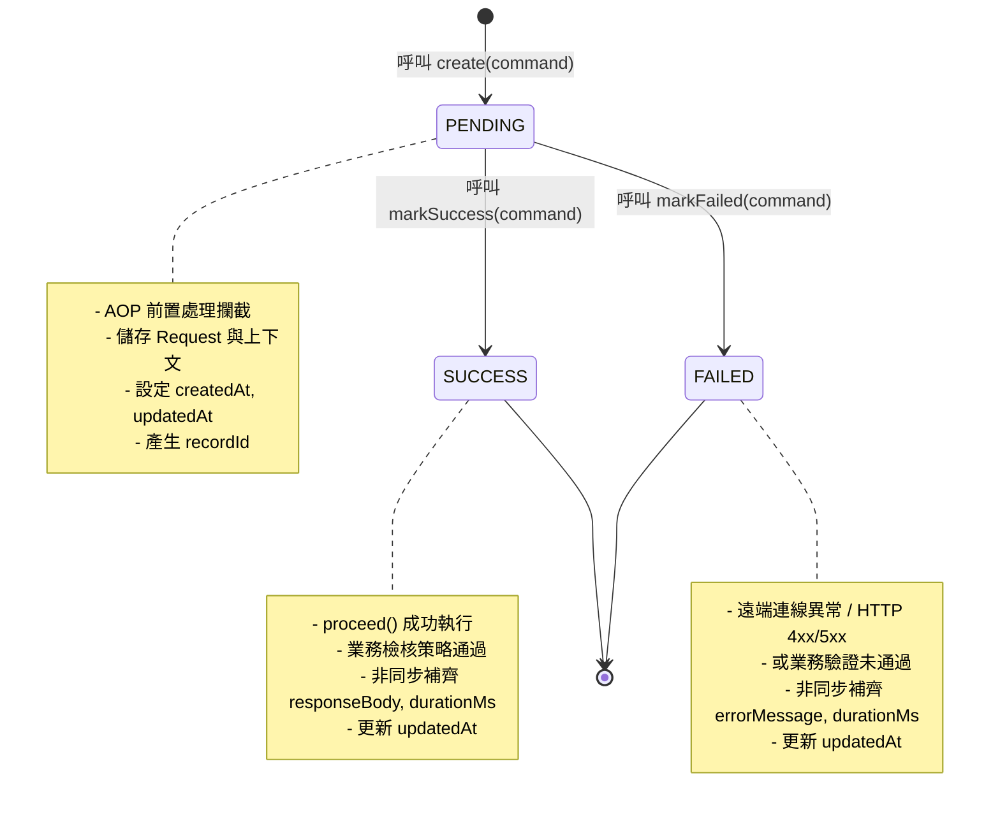
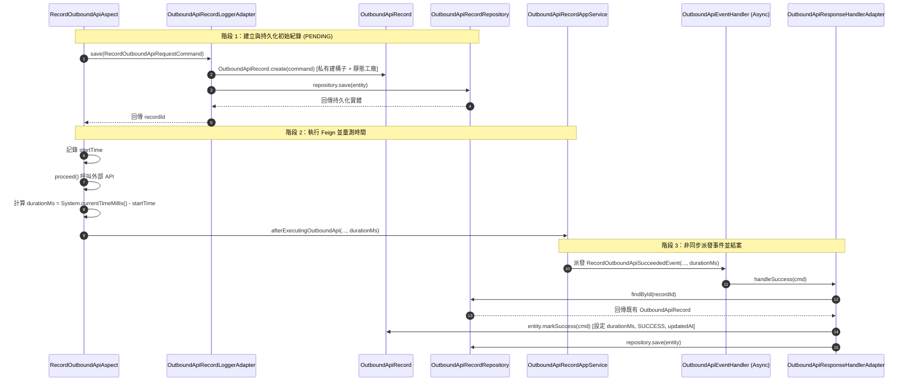

# OutboundApiRecord 實體設計與架構規範說明文件

## 1. 設計定位與背景

在微服務與分散式架構中，系統頻繁需要呼叫第三方或內部其他微服務（Outbound API）。傳統的實作方式常存在紀錄零散、缺乏追溯性、除錯困難等問題。

`OutboundApiRecord` 是本模組核心的持久化實體（JPA Entity），專門負責**追蹤與記錄所有對外 API 呼叫的完整生命週期**，包含呼叫上下文、請求內容、回應資料、執行耗時、例外訊息與最終執行狀態。

---

## 2. Clean Architecture 分層與隔離原則

在 Clean Architecture（六角架構）的設計理念下，本實體嚴格遵循依賴反轉原則（Dependency Inversion Principle）：

```
┌────────────────────────────────────────────────────────┐
│                   Interface Layer                      │
│     (RecordOutboundApiAspect / OutboundApiEventHandler)│
└───────────────────────────┬────────────────────────────┘
                            │
┌───────────────────────────▼────────────────────────────┐
│                  Application Layer                     │
│  - OutboundApiRecordLoggerPort (介面)                  │
│  - OutboundApiResponseHandlerPort (介面)               │
│  - Commands (RecordOutboundApiRequestCommand...)       │
│  * 絕不依賴、不感知 OutboundApiRecord Entity 與 JPA Repository *
└───────────────────────────▲────────────────────────────┘
                            │ 實作 (Adapter)
┌───────────────────────────┴────────────────────────────┐
│                Infrastructure Layer                    │
│  - OutboundApiRecord (JPA Entity)                      │
│  - OutboundApiRecordRepository (Spring Data JPA)       │
│  - OutboundApiRecordLoggerAdapter                      │
│  - AuthServiceApiResponseHandlerAdapter                │
└────────────────────────────────────────────────────────┘
```

### 關鍵隔離機制
1. **防止 ORM/DB 細節侵入核心層**：`Application Layer` 僅處理純 Java POJO 的 `Command` 與抽象的 `Port`。
2. **生命週期解耦**：
   - 建立紀錄時，由 `OutboundApiRecordLoggerAdapter` 將 `RecordOutboundApiRequestCommand` 轉換為 `OutboundApiRecord` 存入 DB，僅回傳 `Long recordId` 給 Application 層。
   - 更新紀錄時，非同步事件處理器透過 `OutboundApiResponseHandlerPort` 與對應的 Adapter，依據 `recordId` 查詢並呼叫實體的狀態轉移方法。

---

## 3. 資料庫欄位定義 (Schema Specification)

* **實體類別**：`entity.com.example.demo.infra.persistence.OutboundApiRecord`
* **資料庫存取介面**：`repository.com.example.demo.infra.persistence.OutboundApiRecordRepository`
* **對應資料表**：`outbound_api_record`

| 欄位名稱 (`Column`) | 資料型別 (`Type`) | 限制 / 預設值 | 說明 | 範例 |
| :--- | :--- | :--- | :--- | :--- |
| `id` | `BIGINT` | 主鍵 (Identity) | 唯一識別碼，作為各層級間串接的代表鍵 | `10001` |
| `system` | `VARCHAR(255)` | NOT NULL | 外部系統代碼或服務識別名稱 | `AuthService`, `PAYMENT` |
| `http_method` | `VARCHAR(50)` | Nullable | HTTP 請求方法 | `GET`, `POST`, `PUT`, `DELETE` |
| `method` | `VARCHAR(255)` | Nullable | 攔截到的 Java 方法名稱 (Method Signature) | `getJwToken`, `queryOrder` |
| `url` (物件屬性: `apiPath`) | `VARCHAR(1000)` | Nullable | 實際發送請求的外部端點 URL 或路徑 | `/api/v1/auth/token` |
| `request_body` | `NVARCHAR(MAX)` / `TEXT` | Nullable | 外部請求的 JSON 內文字串（超過 50,000 字元自動截斷） | `{"clientId":"sys_admin"}` |
| `response_body` | `NVARCHAR(MAX)` / `TEXT` | Nullable | 外部回應的 JSON 內文字串（超過 50,000 字元自動截斷） | `{"token":"eyJhbGci..."}` |
| `error_message` | `NVARCHAR(MAX)` / `TEXT` | Nullable | 發生異常或驗證未通過時的錯誤訊息 | `Connection timeout: 5000ms` |
| `duration_ms` | `BIGINT` | Nullable | API 呼叫執行耗時（毫秒數，可用於 SLA 監控與警報） | `142` |
| `status` | `VARCHAR(50)` | NOT NULL | 呼叫歷程狀態 (枚舉 `OutboundApiStatus`) | `PENDING`, `SUCCESS`, `FAILED` |
| `created_at` | `DATETIME2` / `TIMESTAMP` | NOT NULL | 紀錄初始建立時間戳記 | `2026-11-20 16:00:00` |
| `updated_at` | `DATETIME2` / `TIMESTAMP` | Nullable | 最後更新時間戳記（成功/失敗結案時間） | `2026-11-20 16:00:01` |
| `version` | `BIGINT` | NOT NULL, 預設 0 | 樂觀鎖版本號（`@Version`，防止並發更新衝突） | `1` |

---

## 4. 實體狀態機與生命週期 (Lifecycle & State Transition)

為避免貧血模型（Anemic Domain Model），`OutboundApiRecord` 將狀態異動與業務規則封裝在內部方法中，外部組件無法隨意呼叫 setter 變更狀態。



### 封裝方法詳解

1. **`OutboundApiRecord.create(RecordOutboundApiRequestCommand command)` (靜態工廠方法)**
   - **時機**：外部 API 發出前（Phase 1: Pre-execution）。
   - **行為**：建構子設為 `private`，嚴格透過靜態工廠方法建立實體。初始化 `system`, `method`, `httpMethod`, `apiPath`, `requestBody`（含安全截斷），狀態設為 `OutboundApiStatus.PENDING`，自動寫入 `createdAt` 與 `updatedAt`。

2. **`markSuccess(RecordSuccessOutboundApiCommand command)`**
   - **時機**：API 執行完畢且業務驗證策略通過，非同步事件處理時。
   - **行為**：狀態更新為 `OutboundApiStatus.SUCCESS`，補齊實際的 `apiPath`、`httpMethod`、`responseBody`（含安全截斷）、`durationMs`，並刷新 `updatedAt`。

3. **`markFailed(RecordFailedOutboundApiCommand command)`**
   - **時機**：API 拋出例外或驗證失敗，非同步事件處理時。
   - **行為**：狀態更新為 `OutboundApiStatus.FAILED`，填入 `errorMessage`、`durationMs`，並盡可能記錄當時取得的 `responseBody` 與請求資訊，刷新 `updatedAt`。

---

## 5. 與其他核心元件的協作關係



---

## 6. 維運優化與進階策略實作

本模組已針對正式生產環境（Production）常見的高併發、巨量紀錄與監控需求，實作並規劃了以下四項關鍵優化：

### 6.1 審計欄位與耗時指標 (Audit & Latency Tracking)
- **欄位**：`created_at`、`updated_at`、`duration_ms`。
- **效益**：
  - **SLA 監控**：可直接透過 SQL 或 APM 監控各外部系統的平均響應時間（例如：`SELECT system, AVG(duration_ms) FROM outbound_api_record GROUP BY system`）。
  - **超時分析**：可即時篩選 `duration_ms > 3000` 的慢請求（Slow Requests），作為超時參數調優或降級策略的依據。

### 6.2 資料庫索引規劃 (Database Indexing)
在 `@Table` 註解中預先建立針對核心業務查詢的複合索引：
```java
@Table(
    name = "outbound_api_record",
    indexes = {
        @Index(name = "idx_outbound_system_status", columnList = "system, status"),
        @Index(name = "idx_outbound_created_at", columnList = "created_at")
    }
)
```
- **`idx_outbound_system_status`**：支援管理後台依據特定外部系統（如 `system = 'AuthService'`）與呼叫結果（如 `status = 'FAILED'`）進行分頁篩選與重試排程。
- **`idx_outbound_created_at`**：支援時間範圍統計、Grafana 儀表板趨勢分析，以及後續資料封存清理作業。

### 6.3 大資料量 LOB 自動防護與截斷遮罩 (Payload Protection)
- **問題背景**：外部 API 的 Request/Response 有時可能夾帶大量 Base64 字串、報表或巨型 JSON，直接寫入資料庫會導致 DB Buffer Pool 暴增、磁碟空間快速耗盡與網路 I/O 阻塞。
- **防護實作**：
  在 `OutboundApiRecord` 內部實作 `sanitizePayload()`，預設限制最大字元數為 `50,000`：
  ```java
  private String sanitizePayload(String payload) {
      if (payload == null) return null;
      if (payload.length() > MAX_PAYLOAD_LENGTH) {
          return payload.substring(0, MAX_PAYLOAD_LENGTH) 
                 + "... [TRUNCATED - Payload exceeded " + MAX_PAYLOAD_LENGTH + " chars]";
      }
      return payload;
  }
  ```
  在 `create()`、`markSuccess()`、`markFailed()` 時全面套用，確保入庫資料安全受控。

### 6.4 樂觀鎖策略 (Optimistic Locking)
- **問題背景**：在事件驅動（EDA）架構中，若同一筆 API 紀錄因網路逾時重試、補償事件並行觸發或手動重送，可能產生並發寫入衝突（Race Condition）。
- **實作方式**：
  引入 JPA `@Version private Long version;`。當發生並發寫入時，Hibernate 會自動透過 `WHERE id = ? AND version = ?` 進行檢查；若版本不符會拋出 `OptimisticLockException`，有效防範並發覆蓋（Lost Update）。

### 6.5 資料封存與清理建議 (Data Retention / Archiving)
針對長期維運，建議搭配資料庫排程作業（Cron / Partitioning）進行歷史紀錄維護：
1. **保留期限**：線上熱資料保留 30 ~ 90 天。
2. **冷熱分離**：可依 `created_at` 進行按月分區（Partitioning），歷史分區可卸載至低成本儲存（如 S3、冷備份資料庫）供日後稽核。
